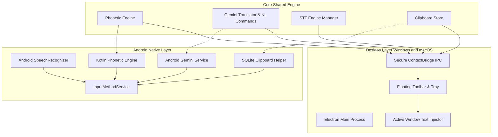

# 🏛️ Technical Architecture Document

## System Overview
Smart Voice Keyboard is an enterprise-grade multi-platform input system engineered for Android, Windows, and macOS. The architecture separates core shared business logic (phonetic transliteration, Gemini API translation, speech-to-text management, and clipboard persistent storage) from platform-specific UI layers (Electron floating desktop interface and Android InputMethodService).

## Module Specifications

### 1. Phonetic Transliteration Engine
- Dual implementation:
  - Node.js/JavaScript: `core/phonetic/phonetic-engine.js`
  - Android Kotlin: `android/app/src/main/java/com/smartvoices/keyboard/phonetic/PhoneticEngine.kt`
- Implements comprehensive vowel, kar, consonant, and conjunct (juktakkhor) mappings with an inherent vowel fallback and high-frequency word dictionary.

### 2. Google Gemini AI Translation
- Direct HTTPS client utilizing Google's Gemini 1.5 Flash API endpoint:
  `https://generativelanguage.googleapis.com/v1beta/models/gemini-1.5-flash:generateContent?key={API_KEY}`
- Optimized system instructions ensure zero conversational bloat, returning strictly the translated or transformed output for direct insertion into input fields.

### 3. Speech-to-Text Pipeline
- Multi-tier STT architecture:
  - **Tier 1 (Streaming/Free)**: System-level continuous speech recognition (W3C Web Speech API in Electron renderer / Android `SpeechRecognizer`).
  - **Tier 2 (Open Source Offline)**: Whisper.cpp / Vosk / Sherpa ONNX models for network-isolated environments.

### 4. Unlimited Clipboard Store
- Persistent database storage:
  - Desktop: JSON / SQLite store with full text search index, deduplication, and pin status.
  - Android: Native SQLiteOpenHelper (`smart_clipboard.db`) with reactive updates via `OnPrimaryClipChangedListener`.

### 5. Automated Multi-Platform CI/CD
- GitHub Actions workflows:
  - `.github/workflows/android-build.yml`: Gradle build generating release APK.
  - `.github/workflows/desktop-build.yml`: Matrix build for Windows NSIS/portable `.exe` and macOS universal `.dmg` / `.zip`.
  - `.github/workflows/release.yml`: Unified release deployment triggered on tag push.
