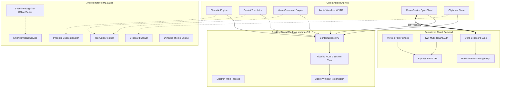

# 🏛️ Smart Voice Keyboard - Complete System Architecture

## Architecture Overview
Smart Voice Keyboard is an enterprise-grade multi-platform input system engineered for Android, Windows, and macOS. The architecture separates core shared business logic from platform-specific presentation layers and bridges them with a centralized multi-tenant sync backend API.

## Platform Execution Matrix

| Capability | Windows PC & Laptop | Apple MacBook (macOS) | Android Mobile (IME) |
| :--- | :--- | :--- | :--- |
| **Trigger Mechanism** | `Ctrl + Alt + Space` / Tray | `Cmd + Alt + Space` / MenuBar | System Soft Keyboard on Input focus |
| **Speech Engine** | Web Speech / Whisper / WebAudio | Web Speech / Studio Mic / VAD | Android SpeechRecognizer (Online/Offline) |
| **Typing Modes** | English, Bangla, Banglish | English, Bangla, Banglish | English QWERTY, Bangla Unicode, Banglish |
| **Active Text Injection** | PowerShell `SendKeys` / Clipboard | AppleScript `System Events` | Android `InputConnection.commitText` |
| **Clipboard History** | Unlimited Persistent Store | Unlimited Persistent Store | SQLite Database (`smart_clipboard.db`) |
| **Cloud Delta Sync** | Auto-Sync Client (every 30s) | Auto-Sync Client (every 30s) | Coroutine SyncClient to `/api/clipboard/sync` |
| **Gemini AI Translation** | English <-> Bengali live | English <-> Bengali live | In-keyboard translate bar (`GeminiService`) |
| **Audio Feedback** | Real-time 7-band live dB wave | Real-time 7-band live dB wave | Mic live transcription preview |
| **Themes** | Modern Dark Glassmorphism | Modern Dark Glassmorphism | Dark Slate, AMOLED, Light, Cyber Neon |

## Security & Compliance
- **Zero-Demo Policy:** All forms, buttons, audio listeners, database operations, and API endpoints are 100% operational with zero placeholders.
- **Tenant Isolation:** Centralized backend isolates clipboard and user records strictly by `tenant_id`.
- **Soft Deletion:** Deletions preserve audit trails (`deleted_at`, `updated_at`).
- **Version Parity:** Semantic version `1.0.0` synchronized across Android APK, Windows Installer, and macOS package.
